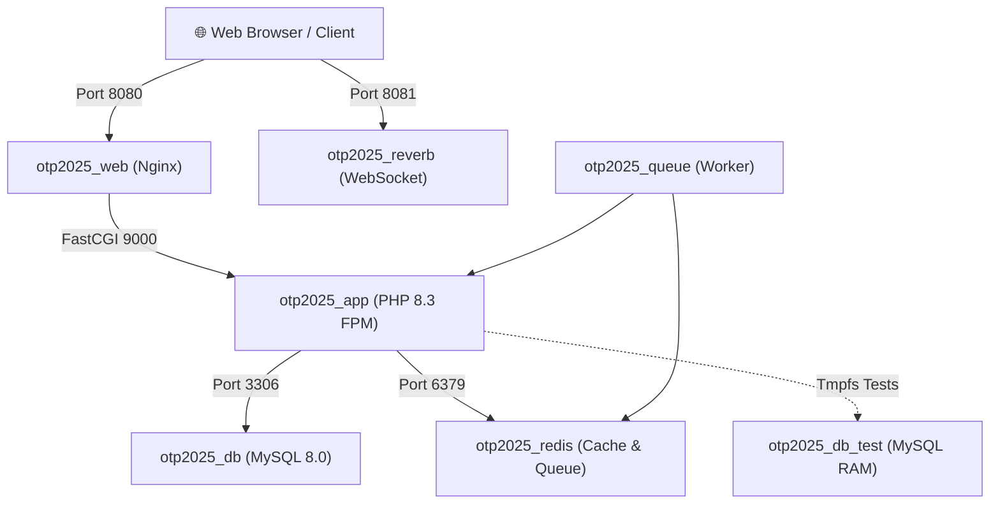

# OTP 2025 — Smart Municipality Platform
### ระบบบริหารจัดการเทศบาลและสิ่งแวดล้อมอัจฉริยะ (Laravel 13 & Docker)

[](https://laravel.com)
[](https://php.net)
[](https://www.docker.com)
[](https://mysql.com)
[](https://redis.io)
[](https://laravel.com/docs/pint)
[](https://phpstan.org)

**OTP 2025** เป็นแพลตฟอร์มเว็บแอปพลิเคชันสำหรับองค์กรปกครองส่วนท้องถิ่น (อปท. / เทศบาล / อบต.) เพื่อยกระดับการให้บริการประชาชนและการจัดการสิ่งแวดล้อมอย่างยั่งยืน รองรับสถาปัตยกรรม **Single-Database Multi-Tenancy** ครอบคลุมงานบริการหลัก 3 ด้าน: ระบบธนาคารขยะรีไซเคิล, ระบบบริหารจัดการน้ำประปาชุมชน และระบบจัดการขยะอินทรีย์/เศษอาหาร

---

## 📑 สารบัญ (Table of Contents)

- [สถาปัตยกรรมและเทคโนโลยี (Tech Stack)](#-สถาปัตยกรรมและเทคโนโลยี-tech-stack)
- [โมดูลหลักของระบบ (Core Domains)](#-โมดูลหลักของระบบ-core-domains)
- [การเริ่มต้นใช้งานอย่างรวดเร็ว (Quickstart)](#-การเริ่มต้นใช้งานอย่างรวดเร็ว-quickstart)
- [คู่มือการใช้งาน Bash Scripts](#-คู่มือการใช้งาน-bash-scripts)
  - [`./start.sh` (เริ่มรันระบบ)](#1-startsh-เริ่มรันระบบ)
  - [`./stop.sh` (หยุดและปิดระบบ)](#2-stopsh-หยุดและปิดระบบ)
  - [`./restart.sh` (รีสตาร์ทระบบ)](#3-restartsh-รีสตาร์ทระบบ)
  - [`./app.sh` (CLI ผู้ช่วยครบวงจร)](#4-appsh-cli-ผู้ช่วยครบวงจร)
- [โครงสร้าง Container (Docker Services)](#-โครงสร้าง-container-docker-services)
- [การตั้งค่า Environment Variables](#-การตั้งค่า-environment-variables)
- [โครงสร้างโฟลเดอร์และหลักการตั้งชื่อ (Architecture Conventions)](#-โครงสร้างโฟลเดอร์และหลักการตั้งชื่อ-architecture-conventions)
- [การทดสอบและตรวจสอบคุณภาพโค้ด (Quality Gates)](#-การทดสอบและตรวจสอบคุณภาพโค้ด-quality-gates)
- [ใบอนุญาต (License)](#-ใบอนุญาต-license)

---

## 🚀 สถาปัตยกรรมและเทคโนโลยี (Tech Stack)

* **Backend Framework:** [Laravel 13](https://laravel.com) (PHP 8.3 Alpine) โครงสร้างแบบ Slim Application Skeleton
* **Web Server:** [Nginx 1.27 Alpine](https://nginx.org)
* **Database:** [MySQL 8.0](https://www.mysql.com) (รองรับ tmpfs test database สำหรับ Unit/Feature Test ความเร็วสูง)
* **In-Memory Cache & Queue:** [Redis Alpine](https://redis.io)
* **Realtime Broadcasting:** [Laravel Reverb](https://laravel.com/docs/reverb) (WebSocket Server)
* **Background Worker:** Laravel Queue Worker
* **Document & OCR Services:** Tesseract OCR (Thai / English) และ DomPDF พร้อมชุดฟอนต์ THSarabunNew
* **Multi-Tenancy:** Single-Database Tenancy ผ่าน Global Scope `BelongsToOrganization` อ้างอิงตาม `org_id_fk`

---

## 🧩 โมดูลหลักของระบบ (Core Domains)

### 1. KeptKaya — ธนาคารขยะรีไซเคิล & จัดการขยะ
* **จุดรับซื้อและจำหน่ายขยะ:** หน้าจอรับซื้อขยะรีไซเคิลเคลื่อนที่และประจำจุด (`RecyclePurchaseController`, `RecycleSaleController`)
* **รายการและราคารับซื้อ:** กำหนดหมวดหมู่ รายการขยะ ราคารับซื้อ และหน่วยนับ (`RecycleItemController`, `RecyclePriceController`, `RecycleUnitController`)
* **ตู้รับซื้อขยะอัจฉริยะ (IoT Smart Kiosk):** เชื่อมต่อเซ็นเซอร์วัดน้ำหนัก วัดระดับขยะ และยืนยันตัวตนผู้ใช้งาน
* **คำนวณคาร์บอนฟุตพริ้นท์:** ประเมินการลดก๊าซเรือนกระจกด้วยค่า Emission Factor
* **ร้านค้าสมาชิก (Member Shop):** สมาชิกนำแต้มสะสมจากการขายขยะมาแลกซื้อสินค้าในชุมชน (`MemberShopController`)
* **รายงานทางราชการ:** จัดทำและพิมพ์แบบรายงาน กก.3 สรุปปริมาณขยะรีไซเคิล (`KorKor3ReportController`)
* **รอบการเบิกจ่าย:** บริหารรอบและอนุมัติการถอนเงินของสมาชิก (`WithdrawBatchController`, `WithdrawApprovalController`)

### 2. Tabwater — ระบบบริหารจัดการน้ำประปาชุมชน
* **ผู้ใช้น้ำและมาตรวัด:** บริหารข้อมูลผู้ใช้น้ำประปา มาตรวัดน้ำ และประเภทอัตราค่าน้ำ (`WaterRateCategoryController`)
* **ระบบจดมิเตอร์เคลื่อนที่ (Mobile Meter Reader):** บันทึกเลขมิเตอร์น้ำพร้อมอัปโหลดภาพถ่ายผ่านมือถือ (`MeterReaderMobileController`)
* **การคำนวณและออกใบแจ้งหนี้:** คำนวณค่าน้ำตามขั้นบันได ออกใบแจ้งหนี้ และพิมพ์ใบเสร็จรับเงิน
* **หนี้ค้างชำระและการตัดมิเตอร์:** ติดตามหนี้ แจ้งเตือนหนังสือค้างชำระ (`OverdueNoticeController`) และระบบสั่งตัด/ถอนมิเตอร์ (`MeterDisconnectionController`)

### 3. Foodwaste — การจัดการขยะเศษอาหาร / ขยะอินทรีย์
* **ถังหมักปุ๋ยอัจฉริยะ (IoT Food Waste Box):** ติดตามข้อมูลอุณหภูมิ ความชื้น และค่าก๊าซในกระบวนการหมักปุ๋ยอินทรีย์ (`FoodWasteIotBoxController`)

### 4. Admin & Multi-Tenancy — ระบบบริหารจัดการองค์กร
* **การบริหารเทศบาล/อปท.:** สลับและจัดการองค์กรตามสิทธิ์ผู้ใช้งาน (`OrganizationAdminController`, `OrganizationSelectorController`)
* **ระบบกำหนดสิทธิ์และบทบาท:** ควบคุมสิทธิ์ละเอียดด้วย Spatie Laravel Permission
* **การแบ่งโซนและเขตบริการ:** จัดการโซนและสายทาง (`SubzoneController`)

---

## ⚡ การเริ่มต้นใช้งานอย่างรวดเร็ว (Quickstart)

### ข้อกำหนดเบื้องต้น (Prerequisites)
* ติดตั้ง [Docker Desktop](https://www.docker.com/products/docker-desktop/) (หรือ Docker Engine + Docker Compose V2)
* Git

### ขั้นตอนติดตั้งใน 3 ขั้นตอน:

```bash
# 1. Clone repository และเปลี่ยนไปที่ branch ล่าสุด
git clone <repository-url> otp2025
cd otp2025
git checkout refactor/upgrade-l13-container

# 2. คัดลอกและตั้งค่า Environment
cp .env.example .env

# 3. รันระบบด้วย start script
./start.sh
```

เมื่อรันสำเร็จ สามารถเข้าถึงระบบได้ที่:
* 🌐 **Web Application:** [http://localhost:8080](http://localhost:8080)
* 📡 **Reverb WebSocket:** `ws://localhost:8081`
* 🗄️ **MySQL Database:** `localhost:33066` *(User: `root`, Password: `root`, DB: `envsogo_main`)*

### 🔑 บัญชีผู้ใช้งานเริ่มต้นสำหรับทดสอบระบบ (Default Credentials)

เข้าใช้งานที่ [http://localhost:8080/login](http://localhost:8080/login) โดยระบุ **Username** และ **Password**:

| Username | Password | Role | สิทธิ์การเข้าถึง |
|---|---|---|---|
| `admin` | `password` | **Super Admin** | ผู้ดูแลระบบสูงสุด (ค่าเริ่มต้นแนะนำ) |
| `admin1` | `999999999` | **Super Admin** | ผู้ดูแลระบบ (ค่าเริ่มต้นเดิมของฟอร์ม) |
| `super admin` | `password` *(หรือ `s@admin`)* | **Super Admin** | บัญชีผู้ดูแลระบบเดิม |
| `water_staff` | `password` | **Tabwater Staff** | เจ้าหน้าที่ระบบประปา / จดมิเตอร์เคลื่อนที่ |
| `recycle_staff` | `password` | **Recycle Bank Staff** | เจ้าหน้าที่ธนาคารขยะรีไซเคิล |
| `finance_staff` | `password` | **Finance Staff** | เจ้าหน้าที่การเงิน |
| `citizen` | `password` | **User** | ประชาชน / สมาชิกธนาคารขยะ |

---

## 🛠️ คู่มือการใช้งาน Bash Scripts

โปรเจกต์จัดเตรียม Bash Scripts ที่ออกแบบมาเพื่ออำนวยความสะดวกในการพัฒนาบน Container:

### 1. `./start.sh` (เริ่มรันระบบ)
เปิดใช้งาน Services ทั้งหมดใน background พร้อมตรวจสอบความสมบูรณ์ของระบบอัตโนมัติ:
* ตรวจสอบว่า Docker daemon ทำงานอยู่หรือไม่
* ดึง `UID` และ `GID` ของเครื่อง Host อัตโนมัติ เพื่อป้องกันปัญหาสิทธิ์ไฟล์ (Permission Denied)
* ตรวจสอบไฟล์ `.env` และสร้าง Application Key ให้อัตโนมัติหากยังไม่มี
* รอ Healthcheck ของ MySQL Database จนพร้อมทำงาน
* ตั้งค่า Permission ของโฟลเดอร์ `storage/` และ `bootstrap/cache/`

```bash
# รันปกติ
./start.sh

# รันพร้อมสั่ง Rebuild Image ใหม่
./start.sh --build
```

### 2. `./stop.sh` (หยุดและปิดระบบ)
หยุดการทำงานของ Containers และ Network ทั้งหมดอย่างปลอดภัย:

```bash
# หยุดการทำงานโดยรักษาข้อมูลใน Volume ไว้
./stop.sh

# หยุดการทำงานพร้อมลบ Volume ฐานข้อมูล (มีระบบถามยืนยันเพื่อความปลอดภัย)
./stop.sh -v
```

### 3. `./restart.sh` (รีสตาร์ทระบบ)
สั่งปิดระบบและเริ่มใหม่อัตโนมัติ:

```bash
./restart.sh
```

### 4. `./app.sh` (CLI ผู้ช่วยครบวงจร)
สคริปต์ Swiss Army Knife สำหรับสั่งการ Container โดยไม่ต้องพิมพ์คำสั่ง `docker compose exec ...` ขนาดยาว:

#### 🔹 คำสั่ง Lifecycle & Logs
```bash
./app.sh start           # เริ่มระบบ (เรียก ./start.sh)
./app.sh stop            # หยุดระบบ (เรียก ./stop.sh)
./app.sh restart         # รีสตาร์ทระบบ
./app.sh status          # ดูสถานะ Container (docker compose ps)
./app.sh logs            # ดู Log ทั้งหมดแบบ Realtime (Follow)
./app.sh logs app        # ดู Log เฉพาะ service app
./app.sh logs queue      # ดู Log การทำงานของ Queue Worker
```

#### 🔹 คำสั่งพัฒนาโค้ด (Artisan / Composer)
```bash
./app.sh artisan route:list          # รันคำสั่ง Artisan
./app.sh artisan make:controller ... # สร้างไฟล์ผ่าน Artisan
./app.sh composer require <package>  # ติดตั้ง Composer Package ใหม่
./app.sh composer dump-autoload      # อัปเดต Autoload
```

#### 🔹 ฐานข้อมูลและแคช (Database & Cache)
```bash
./app.sh migrate                     # รัน Migration
./app.sh migrate --seed              # รัน Migration พร้อม Seeder
./app.sh seed                        # รันเฉพาะ Seeder
./app.sh mysql                       # เปิด MySQL CLI เข้าสู่ฐานข้อมูล envsogo_main
./app.sh redis                       # เปิด Redis CLI
./app.sh cache-clear                 # ล้าง Config, Route, View แคชทั้งหมด
```

#### 🔹 คุณภาพโค้ดและการทดสอบ (Quality Gates)
```bash
./app.sh test                        # รัน PHPUnit / Pest Test Suite ทั้งหมด
./app.sh test --filter=Admin         # รันเฉพาะ Test ที่ตรงกับชื่อ
./app.sh pint                        # รัน Laravel Pint จัด Code Style
./app.sh phpstan                     # รัน PHPStan Static Analysis ตรวจสอบ Type
```

#### 🔹 การเข้าถึง Terminal ใน Container (Shell Access)
```bash
./app.sh shell                       # เข้า Bash Shell ใน Container ด้วย user www-data
./app.sh root-shell                  # เข้า Bash Shell ด้วย user root (สำหรับงานแอดมิน)
```

---

## 🐳 โครงสร้าง Container (Docker Services)

ไฟล์ [`compose.yaml`](file:///Users/poppy.geidtiphong/Documents/workspace/homework/otp2025/compose.yaml) กำหนดการทำงานของ 7 Services หลัก:



| Service | Container Name | รายละเอียด | พอร์ตภายนอก |
|---|---|---|---|
| `app` | `otp2025_app` | PHP 8.3.36 FPM พร้อม Extension ครบชุด (GD, Redis, Pdo_mysql, BCMath, Intl, Zip, OCR) | ภายใน |
| `web` | `otp2025_web` | Nginx 1.27 Alpine ทำหน้าที่ Reverse Proxy และให้บริการ Static Assets | `8080:80` |
| `db` | `otp2025_db` | MySQL 8.0 ฐานข้อมูลหลัก จัดเก็บใน Docker Volume `dbdata` | `33066:3306` |
| `db_test` | `otp2025_db_test` | MySQL 8.0 ทำงานบน Tmpfs (RAM) สำหรับรัน Test Suites ความเร็วสูง | ภายใน |
| `redis` | `otp2025_redis` | Redis Alpine สำหรับจัดการ Cache และ Message Queue | ภายใน |
| `reverb` | `otp2025_reverb` | Laravel Reverb จัดการ Real-time Event Broadcasting | `8081:8081` |
| `queue` | `otp2025_queue` | Laravel Queue Worker จัดการงานประมวลผลเบื้องหลัง | ภายใน |

---

## ⚙️ การตั้งค่า Environment Variables

สามารถปรับเปลี่ยนพอร์ตและการเชื่อมต่อผ่านไฟล์ `.env` ได้โดยตรง:

```env
# พอร์ตการเชื่อมต่อภายนอกของ Docker
APP_PORT=8080             # พอร์ตของ Web Browser (http://localhost:8080)
FORWARD_DB_PORT=33066     # พอร์ต MySQL สำหรับโปรแกรมเชื่อมต่อเช่น DBeaver / TablePlus
REVERB_PORT=8081          # พอร์ต WebSocket ของ Laravel Reverb

# การเชื่อมต่อฐานข้อมูลภายใน Container Stack
DB_CONNECTION=mysql
DB_HOST=db
DB_PORT=3306
DB_DATABASE=envsogo_main
DB_USERNAME=root
DB_PASSWORD=root

# การเชื่อมต่อ Redis
REDIS_HOST=redis
REDIS_PASSWORD=null
REDIS_PORT=6379

# การเชื่อมต่อ Reverb
REVERB_APP_ID=otp2025
REVERB_APP_KEY=otp2025key
REVERB_APP_SECRET=otp2025secret
REVERB_HOST=reverb
REVERB_PORT=8081
REVERB_SCHEME=http
```

---

## 📐 โครงสร้างโฟลเดอร์และหลักการตั้งชื่อ (Architecture Conventions)

โค้ดเบสได้รับการปรับปรุงให้ตรงตามมาตรฐานสากลของ **Laravel 13**:

```
otp2025/
├── app/
│   ├── Actions/                 # Business Logic แยกตาม Domain (Action Pattern)
│   ├── Http/
│   │   ├── Controllers/
│   │   │   ├── Admin/           # Controller ผู้ดูแลระบบ (Subzone, OrganizationAdmin, ...)
│   │   │   ├── KeptKaya/        # Controller ธนาคารขยะ (RecyclePurchase, RecycleSale, ...)
│   │   │   ├── Tabwater/        # Controller ระบบประปา (OverdueNotice, MeterReader, ...)
│   │   │   └── FoodWaste/       # Controller ขยะอินทรีย์ (FoodWasteIotBoxController, ...)
│   │   └── Requests/            # FormRequest สำหรับตรวจสอบความถูกต้องของข้อมูล (Validation)
│   └── Models/                  # Eloquent Models (ใช้ casts(): array และคุ้มครอง Mass Assignment)
├── bootstrap/
│   ├── app.php                  # Laravel 13 Slim Application Configuration
│   └── providers.php            # Service Providers Registration
├── database/
│   ├── migrations/              # Database Migrations
│   └── schema/mysql-schema.sql  # Schema Dump สำหรับการ Migrate ที่เสถียรและรวดเร็ว
├── docker/
│   ├── mysql-init/              # สคริปต์สร้าง Database อัตโนมัติ (envsogo_main, envsogo_test)
│   ├── nginx/                   # คอนฟิกูเรชัน Nginx
│   └── php/                     # Dockerfile และ php.ini
├── docs/                        # เอกสารระบบและบันทึกรายงานการ Refactor
├── routes/
│   ├── admin.php                # เส้นทางระบบผู้ดูแลระบบ
│   ├── api.php                  # API Endpoints
│   ├── foodwaste.php            # เส้นทางระบบขยะอินทรีย์
│   ├── keptkaya.php             # เส้นทางระบบธนาคารขยะรีไซเคิล
│   ├── tabwater.php             # เส้นทางระบบประปา
│   └── web.php                  # หน้าเว็บหลักและการเข้าสู่ระบบ
├── start.sh                     # สคริปต์เริ่มรัน Stack
├── stop.sh                      # สคริปต์หยุด Stack
├── restart.sh                   # สคริปต์รีสตาร์ท Stack
├── app.sh                       # CLI ช่วยสั่งการทำงาน
└── compose.yaml                 # Docker Compose Configuration
```

### การตั้งชื่อ Controller ตามหน้าที่ (Functionality-Driven Naming)
* **KeptKaya:** แทนที่คำนำหน้า `Kp` ด้วยคำสื่อความหมายสากล เช่น `RecyclePurchaseController`, `RecycleSaleController`, `RecycleItemController`, `RecyclePriceController`, `WithdrawBatchController`
* **Tabwater:** สื่อหน้าที่การทำงาน เช่น `OverdueNoticeController` (แจ้งเตือนค้างชำระ), `MeterReaderAssignmentController` (มอบหมายงานจดมิเตอร์), `MeterDisconnectionController` (ตัดมิเตอร์)

---

## 🧪 การทดสอบและตรวจสอบคุณภาพโค้ด (Quality Gates)

โปรเจกต์มีระบบ Automated Testing และ Static Analysis ครบวงจร:

```bash
# 1. รัน Test Suites (33 tests, 58 assertions)
./app.sh test

# 2. ตรวจสอบ Static Type ด้วย PHPStan (0 errors)
./app.sh phpstan

# 3. ตรวจสอบรูปแบบโค้ดตามมาตรฐาน Laravel Pint
./app.sh pint --test

# 4. ทดสอบความถูกต้องของการ Compile เส้นทาง
./app.sh artisan route:cache && ./app.sh artisan route:clear
```

---

## 📄 ใบอนุญาต (License)

ซอฟต์แวร์นี้เป็นลิขสิทธิ์ของทีมพัฒนาโครงการ OTP 2025 สำหรับใช้งานในภารกิจการบริหารจัดการท้องถิ่น
