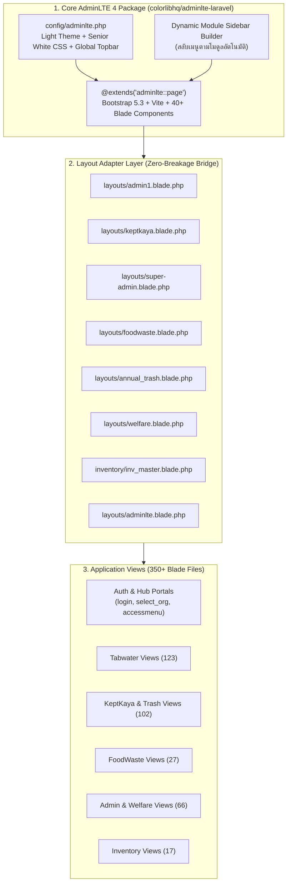

# แผนการย้ายระบบ UI ทั้งหมดสู่ AdminLTE 4 (`colorlibhq/adminlte-laravel`)

**แพ็กเกจหลัก:** [`ColorlibHQ/adminlte-laravel`](https://github.com/ColorlibHQ/adminlte-laravel) (Official AdminLTE 4 for Laravel 13 & Bootstrap 5.3)  
**กลุ่มเป้าหมายผู้ใช้:** เจ้าหน้าที่เทศบาลและประชาชน อายุ 40+ ปี (คงเอกลักษณ์โทนสีขาวสะอาด Senior-Friendly White Theme)  
**เป้าหมาย:** รวมศูนย์ Layout ทั้งหมดของระบบ (กว่า 350+ หน้าจอ Blade) เข้าสู่มาตรฐาน **AdminLTE 4** เดียวกันทั้งหมด โดยไม่ทำให้ฟีเจอร์เดิมหรือ JavaScript เดิมพัง

---

## 1. การวิเคราะห์ความพร้อมของระบบปัจจุบัน (System Readiness Audit)

จากการตรวจสอบโครงสร้างโค้ดปัจจุบันของโปรเจกต์ `otp2025` พบข้อมูลสำคัญดังนี้:

### 1.1 ความเข้ากันได้ของเทคโนโลยี (Stack Compatibility)
| ส่วนประกอบ | ความต้องการของ `colorlibhq/adminlte-laravel` | สถานะปัจจุบันของ `otp2025` | แนวทางดำเนินการ |
|---|---|---|---|
| **PHP Version** | PHP `^8.3` | **PHP `^8.3`** (พร้อมแล้ว) | ไม่ต้องอัพเกรดเพิ่ม |
| **Laravel Version** | Laravel `^13.0` | **Laravel `^13.0`** (พร้อมแล้ว) | ไม่ต้องอัพเกรดเพิ่ม |
| **CSS Framework** | Bootstrap `5.3.x` | Bootstrap `5.x` (Soft UI) + Tailwind บางส่วน | เข้ากันได้ทันทีกับ Grid (`row`, `col-*`, `card`, `btn`) |
| **Asset Bundler** | **Vite** (`laravel-vite-plugin`) | Laravel Mix (`webpack.mix.js`) | ติดตั้ง Vite และสร้าง `vite.config.js` ควบคู่กัน |
| **JavaScript** | Vanilla JS (Zero jQuery ในตัว AdminLTE 4) | มี Inline jQuery (`$`, `$.ajax`, DataTables, Select2) ใน Blade กว่า 150 ไฟล์ | โหลด `jquery-3.7.0.min.js` เป็น Global Script ใน Master Layout เพื่อให้โค้ดเก่าทำงานได้ 100% |

### 1.2 ปริมาณไฟล์ Blade แยกตาม Layout ปัจจุบัน (รวม ~370 ไฟล์)
จากการสแกน `@extends(...)` ทั้งโปรเจกต์:
1. `layouts.admin1` — **123 ไฟล์** (ระบบประปา Tabwater และงานทะเบียนกลาง)
2. `layouts.keptkaya` — **77 ไฟล์** (ธนาคารขยะรีไซเคิล KeptKaya)
3. `layouts.super-admin` — **58 ไฟล์** (ผู้ดูแลระบบกลาง Super Admin)
4. `layouts.foodwaste` — **27 ไฟล์** (ระบบขยะอินทรีย์และ IoT)
5. `layouts.adminlte` — **27 ไฟล์** (ไฟล์เดิมที่อ้างชื่อ `layouts.adminlte` ไว้แล้ว)
6. `layouts.annual_trash` — **25 ไฟล์** (ระบบค่าธรรมเนียมขยะรายปี)
7. `inventory.inv_master` — **17 ไฟล์** (ระบบคลังพัสดุ)
8. `layouts.welfare` — **8 ไฟล์** (ระบบสวัสดิการชุมชน)
9. `layouts.tabwater_staff_mobile` / `keptkaya_mobile` / `user_mobile` — **15 ไฟล์** (หน้าจอมือถือภาคสนาม)
10. `layouts.print` / `layouts.plain` — **30 ไฟล์** *(คงไว้สำหรับการพิมพ์เอกสาร PDF/กระดาษ)*

---

## 2. สถาปัตยกรรมการออกแบบ (Target Architecture)



### จุดเด่นของสถาปัตยกรรมนี้:
1. **Single Source of Truth:** ควบคุม Header, Sidebar, Footer, CSS และ JS จากศูนย์กลางที่ `adminlte::page` และ `config/adminlte.php` เพียงจุดเดียว
2. **Legacy Section Mapping (สะพานเชื่อม `@yield` อัตโนมัติ):**
   หน้า Blade เดิมในโปรเจกต์ใช้ชื่อ `@section` ที่หลากหลาย เช่น `@section('style')`, `@section('styles')`, `@section('script')`, `@section('scripts')`, `@section('page-topic')`, `@section('nav-current')`  
   เราจะสร้าง **Adapter Layout** ที่แมป Section เหล่านี้เข้าสู่มาตรฐานของ AdminLTE 4 (`content_header`, `content`, `css`, `js`) โดยอัตโนมัติ ทำให้ไม่ต้องแก้ไฟล์ย่อยทีละไฟล์ให้เสี่ยงพัง
3. **Context-Aware Dynamic Sidebar:**
   ใช้ความสามารถ Menu Builder ของ `colorlibhq/adminlte-laravel` ตรวจสอบ URL ปัจจุบัน:
   - หากอยู่ใน `/tabwater/*` หรือ `/cutmeter/*` ➔ แสดงเมนูขั้นตอนงานประปา (Step 1–5)
   - หากอยู่ใน `/keptkayas/*` ➔ แสดงเมนูขั้นตอนธนาคารขยะ (Step 1–6)
   - หากอยู่ใน `/foodwaste/*` ➔ แสดงเมนูขั้นตอนขยะอินทรีย์ (Step 1–5)
   - หากอยู่ใน `/inventory/*` ➔ แสดงเมนูคลังพัสดุ (Step 1–3)
   - หากอยู่ใน `/admin/welfare/*` ➔ แสดงเมนูกองทุนสวัสดิการ (Step 1–4)
   - หากอยู่ใน `/admin/*` ➔ แสดงเมนูผู้ดูแลระบบกลาง
   พร้อมปุ่ม **"🏠 หน้าศูนย์รวมระบบงาน"** และ **Quick Module Switcher** บนแถบ Navbar ด้านบนเสมอ

---

## 3. แผนการดำเนินงานแบ่งตามระยะ (Phased Implementation Plan)

### Phase 1: ติดตั้ง `colorlibhq/adminlte-laravel` และตั้งค่า Vite Pipeline
**เป้าหมาย:** ติดตั้งแพ็กเกจหลักและเตรียมระบบ Build Assets ให้พร้อมใช้งานใน Docker

1. **ติดตั้ง Composer Package:**
   ```bash
   ./app.sh composer require colorlibhq/adminlte-laravel
   ./app.sh artisan adminlte:install
   ```
2. **ติดตั้ง Vite & Frontend Dependencies:**
   - เพิ่ม `vite` และ `laravel-vite-plugin` ใน `package.json`
   - สร้างไฟล์ `vite.config.js` สำหรับคอมไพล์ `resources/css/adminlte.css` และ `resources/js/adminlte.js`
   - รัน `npm install && npm run build` เพื่อสร้างไฟล์ Production Build ลงใน `public/build/` (ทำให้รันผ่าน Docker และ E2E Test ได้ทันทีโดยไม่ต้องเปิด Vite Dev Server ค้างไว้)
3. **ตั้งค่า `config/adminlte.php`:**
   - ตั้งค่าแบรนด์โลโก้ (`logo/ko_envsogo.png`) และชื่อระบบเทศบาล
   - บังคับโหมดสีสว่าง (`'ColorMode' => 'light'`, `data-bs-theme="light"`)
   - ปิด Demo Routes (`'demo' => false`)
   - เปิดใช้งาน Plugins ที่จำเป็น (Chart.js, DataTables, Select2, SweetAlert2, FontAwesome 6/5)

---

### Phase 2: ปรับแต่งธีม AdminLTE 4 โทนสีขาวสำหรับผู้สูงวัย (Senior-Friendly White Theme)
**เป้าหมาย:** ผสาน `senior-white-theme.css` เข้ากับ AdminLTE 4 Bootstrap 5.3 Variables

1. **ปรับแต่ง CSS Variables ของ AdminLTE 4 (`resources/css/adminlte-custom-senior.css`):**
   - `--bs-body-bg: #F8FAFC;` (พื้นหลังขาวอมเทาอ่อน สบายตา)
   - `--bs-body-color: #0F172A;` (ตัวอักษรสีดำเข้ม คมชัดสูง)
   - `--bs-body-font-family: 'Sarabun', sans-serif;`
   - `--bs-body-font-size: 1.0625rem;` (17px มาตรฐาน)
   - `--lte-sidebar-width: 280px;` (ขยายความกว้าง Sidebar ให้อ่านเมนูภาษาไทยได้เต็มบรรทัด ไม่ถูกตัดคำ)
   - `--lte-sidebar-bg: #FFFFFF;` (Sidebar พื้นหลังสีขาวสะอาด ขอบขวาคมชัด `#E2E8F0`)
2. **ปรับแต่ง Active Menu & Buttons:**
   - เมนูที่เลือกอยู่ (`.nav-link.active`) ใช้พื้นหลังสีฟ้าอ่อน `#E0F2FE` ตัวอักษรสีน้ำเงินเข้ม `#0369A1` พร้อมแถบสีด้านซ้ายหนา 4px
   - ความสูงของปุ่ม `.btn` และ `.form-control` ขั้นต่ำ `48px`

---

### Phase 3: สร้างระบบ Dynamic Sidebar Menu & Global Navbar
**เป้าหมาย:** ย้ายเมนูจากไฟล์ `*_navigation.blade.php` ทั้ง 6 ไฟล์ มาไว้ในระบบจัดการเมนูของ AdminLTE 4

1. **สร้างคลาส `App\Support\AdminLteMenuBuilder`:**
   - แยกชุดเมนูตามโมดูล (Tabwater, KeptKaya, Annual Trash, FoodWaste, Inventory, Welfare, Super Admin)
   - เรียงลำดับเมนูเป็นขั้นตอนที่เข้าใจง่าย (Step 1, Step 2, Step 3...)
   - รองรับการตรวจสอบสิทธิ์ Spatie Permission (`can` / `role`)
2. **ปรับแต่ง Top Navbar (`vendor/adminlte/partials/navbar`):**
   - ซ้าย: ปุ่มพับ/กาง Sidebar + ปุ่ม **"🏠 หน้าศูนย์รวมระบบงาน (`/accessmenu`)"** + ป้ายชื่อหน่วยงานเทศบาลปัจจุบัน
   - ขวา: ปุ่ม Dropdown **"สลับระบบงานด่วน (Quick Switcher)"** + ชื่อผู้ใช้งาน + ปุ่มออกจากระบบสีแดงชัดเจน

---

### Phase 4: สร้าง Layout Adapters & แปลงหน้า Auth / Portal หลัก
**เป้าหมาย:** เชื่อมต่อหน้าจอทั้งหมดกว่า 350+ หน้าเข้ากับ AdminLTE 4 โดยไม่ให้โค้ดเดิมพัง

1. **Publish Views ของ AdminLTE 4 (`resources/views/vendor/adminlte/`):**
   - เพิ่มการโหลด `jquery-3.7.0.js`, `sweetalert2`, `select2`, `datatables` ใน Master Layout เพื่อให้ `@section('script')` ในหน้าเก่าทำงานได้ 100%
   - รองรับทั้ง `@yield('content')`, `@yield('style')`/`@yield('styles')`, `@yield('script')`/`@yield('scripts')`
2. **ปรับปรุง Layout ทั้ง 8 ไฟล์ให้สืบทอดจาก `adminlte::page`:**
   - `resources/views/layouts/admin1.blade.php` ➔ `@extends('adminlte::page')`
   - `resources/views/layouts/super-admin.blade.php` ➔ `@extends('adminlte::page')`
   - `resources/views/layouts/keptkaya.blade.php` ➔ `@extends('adminlte::page')`
   - `resources/views/layouts/annual_trash.blade.php` ➔ `@extends('adminlte::page')`
   - `resources/views/layouts/foodwaste.blade.php` ➔ `@extends('adminlte::page')`
   - `resources/views/layouts/welfare.blade.php` ➔ `@extends('adminlte::page')`
   - `resources/views/layouts/adminlte.blade.php` ➔ `@extends('adminlte::page')`
   - `resources/views/inventory/inv_master.blade.php` ➔ `@extends('adminlte::page')`
3. **ปรับโฉมหน้าหลักด้วย Native AdminLTE 4 Blade Components:**
   - **หน้า Login (`auth/login.blade.php`):** ใช้โครงสร้าง AdminLTE 4 Auth Card (`login-box`, `card-outline card-primary`)
   - **หน้าเลือกหน่วยงาน (`admin/select_org.blade.php`):** ใช้ `<x-adminlte-card>`
   - **หน้าศูนย์รวมระบบงาน (`accessmenu.blade.php` & `staff_accessmenu.blade.php`):** ใช้ `<x-adminlte-small-box>` และ `<x-adminlte-info-box>` ของ AdminLTE 4
   - **หน้า Dashboard ของแต่ละโมดูล:** ใช้ `<x-adminlte-small-box>`, `<x-adminlte-info-box>`, และ `<x-adminlte-card>`

---

### Phase 5: ตรวจสอบความสมบูรณ์และรันทดสอบ E2E ครบ 39 หน้าจอ
**เป้าหมาย:** ยืนยันว่าทุกหน้าจอแสดงผลด้วย AdminLTE 4 ได้อย่างสมบูรณ์ ไม่มี Error

1. **Automated Test Suite:** รัน `./app.sh test` ให้ผ่านครบทั้ง 53 Tests (100%)
2. **Static Analysis & Code Style:** รัน `./app.sh phpstan` (0 errors) และ `./app.sh pint`
3. **Visual E2E Capture:** รัน `node scripts/run_all_e2e_capture.js` เพื่อบันทึกภาพหน้าจอใหม่ในโฉม **AdminLTE 4 Clean White** ครบทั้ง 39 หน้าจอลงใน `docs/screenshots/`

---

## 4. ตารางสรุปการแมป Component สู่ AdminLTE 4

| ส่วนประกอบเดิม (Soft UI / Custom) | ส่วนประกอบใหม่ใน AdminLTE 4 (`colorlibhq/adminlte-laravel`) | ประโยชน์ที่ได้รับ |
|---|---|---|
| `<div class="card">` ทั่วไป | `<x-adminlte-card title="..." theme="primary" icon="fas fa-...">` | โครงสร้างหัวข้อและการ์ดมาตรฐานเดียวกัน มีปุ่มย่อ/ขยายในตัว |
| กล่องตัวเลขสถิติ Dashboard | `<x-adminlte-small-box title="..." text="..." icon="..." theme="info" url="..."/>` | ตัวเลขใหญ่ชัดเจน มีลิงก์กดดูรายละเอียดได้ทันที |
| กล่องข้อมูลสรุปย่อย | `<x-adminlte-info-box title="..." text="..." icon="..." theme="success"/>` | อ่านง่าย สัดส่วนสวยงาม รองรับ Progress bar |
| ตารางข้อมูลทั่วไป | `<table class="table table-bordered table-hover align-middle">` ใน `<x-adminlte-card>` | เส้นตารางชัดเจน ไม่ลายตาสำหรับผู้สูงวัย |
| แถบเมนูแยก 7 ไฟล์ | `config/adminlte.php` + `AdminLteMenuBuilder` | แก้ไขเมนูที่เดียวมีผลทั้งระบบ รองรับการเช็คสิทธิ์อัตโนมัติ |
