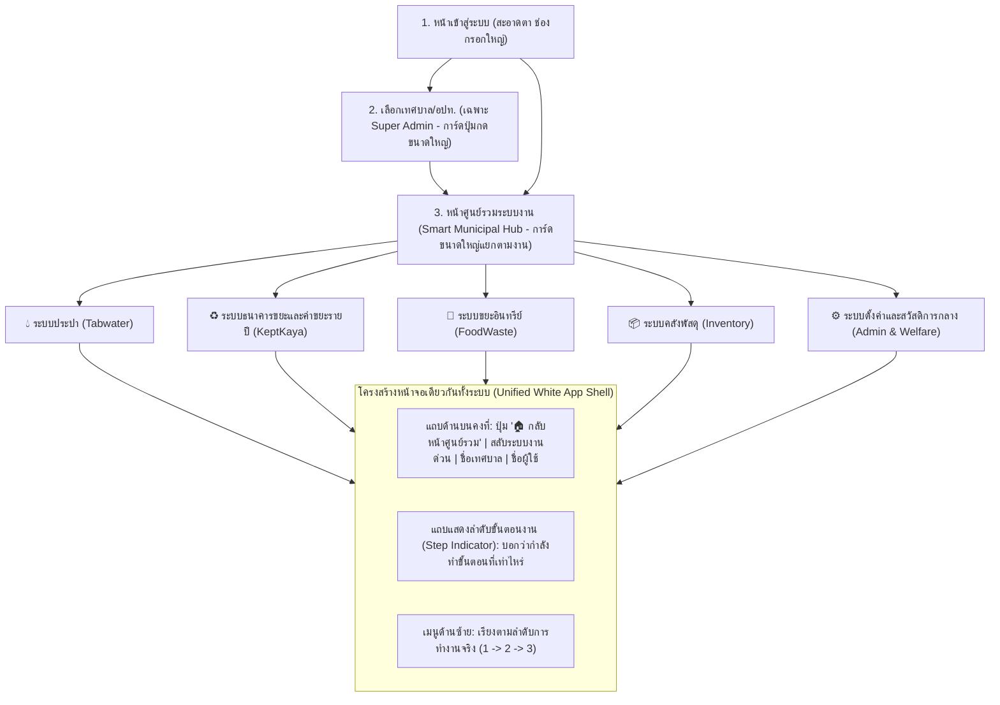

# แผนแม่บทการ Re-design UX/UI และปรับปรุง Workflow ทั้งระบบ (OTP 2025)

**แนวคิดหลัก (Core Concept):** *"ขาวสะอาดตา ตัวหนังสือใหญ่ ปุ่มกดชัด ภาษาเข้าใจง่าย งานต่อเนื่องไม่หลงทาง"*  
**กลุ่มเป้าหมายหลัก (Target Persona):** เจ้าหน้าที่เทศบาล/อปท. อาสาสมัคร และประชาชน อายุ 40 ปีขึ้นไป ที่ไม่คุ้นเคยกับการใช้คอมพิวเตอร์ซับซ้อน  
**วันที่จัดทำ:** 1 พฤศจิกายน 2026  

---

## 1. การวิเคราะห์ปัญหา UX/UI ปัจจุบัน (Pain Points Audit จาก 39 หน้าจอจริง)

จากการตรวจสอบโค้ดและภาพหน้าจอทั้ง 39 หน้าใน [`docs/screenshots/`](./screenshots/) พบปัญหาหลักที่ทำให้ผู้ใช้อายุ 40+ ใช้งานยากและสับสน ดังนี้:

1. **หน้าเมนูหลัก (`resources/views/accessmenu.blade.php`) เป็นวงกลมหมุนซับซ้อน:**
   - ใช้กราฟิกวงกลมหมุน (`@keyframes rotateMain`) วางไอคอนลอยรอบทิศทาง ทำให้กวาดสายตาหาเมนูยาก ไม่รู้ว่าต้องเริ่มคลิกจากจุดไหนก่อน
2. **ตัวหนังสือเล็กและช่องกรอกข้อมูลแคบมาก (`admin1.blade.php`, `foodwaste.blade.php`):**
   - มีการกำหนด CSS `.form-control { padding: 0.2rem !important; font-size: 0.875rem (14px); }` และ `.table th { padding: 0.2rem !important; }` ทำให้ตารางและช่องกรอกข้อมูลเบียดเสียด กดผิดง่าย และต้องเพ่งสายตาตลอดเวลา
3. **โทนสีไม่เป็นหนึ่งเดียวกัน (Theme Fragmentation):**
   - โมดูลขยะอินทรีย์ (FoodWaste) ใช้พื้นหลังสีดำมืด (`#1e293b` Dark Mode) โมดูลประปาใช้สีม่วง-ชมพูฉูดฉาดของ Soft UI โมดูลคลังพัสดุใช้สีน้ำเงินเข้มของ Bootstrap แยกขาดจากกัน
4. **หลงทางเวลาข้ามโมดูล (Broken Workflow & Navigation):**
   - มีไฟล์ Layout แยกกันมากกว่า **25 ไฟล์** ใน `resources/views/layouts/` เมื่อคลิกเข้าโมดูลใดโมดูลหนึ่ง แถบเมนูจะเปลี่ยนไปทั้งหมด ไม่มีแถบนำทางส่วนกลาง (Global Topbar) ที่บอกชัดเจนว่า *"ตอนนี้อยู่ที่ไหน"* หรือปุ่ม *"กลับหน้าหลัก / สลับระบบงาน"* ที่อยู่ในตำแหน่งเดิมเสมอ
5. **คำศัพท์เทคนิคปนภาษาอังกฤษ:**
   - มีการใช้คำทับศัพท์หรือคำย่อเทคนิค เช่น `SKUs`, `TBank`, `Subzone`, `Cutmeter`, `IoT Boxes`, `Invoice Period`, `Action` ซึ่งผู้ใช้งานที่ไม่คล่องคอมพิวเตอร์ต้องเสียเวลาตีความ

---

## 2. มาตรฐานการออกแบบใหม่ (Design System สำหรับวัย 40+ "Clean White & Comfort")

### 2.1 โทนสีขาวสบายตา (Clean White & Soft Daylight Palette)
เน้นพื้นหลังสีขาวและเทาอ่อนนวลตา เพื่อลดแสงสะท้อน (Anti-glare) แต่ให้ความคมชัดของตัวอักษรสูงสุดตามมาตรฐาน WCAG AAA:

| บทบาทของสี | รหัสสี (Hex) | การนำไปใช้งาน |
|---|---|---|
| **พื้นหลังหน้าเว็บ (App Background)** | `#F8FAFC` (ขาวอมเทาอ่อนนวล) | พื้นหลังหลักของระบบ ช่วยลดความจ้าของสีขาวล้วนเวลาจ้องจอนานๆ |
| **พื้นหลังการ์ด/ตาราง/แถบเมนู (Surface)** | `#FFFFFF` (ขาวสะอาด) | กล่องข้อมูล ตาราง ฟอร์มกรอกข้อมูล และแถบเมนูด้านซ้าย |
| **เส้นขอบแยกสัดส่วน (Border)** | `#CBD5E1` (เทาชัดเจน) | เส้นขอบช่องกรอกข้อมูลและตาราง (หนา `1.5px` เพื่อให้มองเห็นกรอบชัดเจน) |
| **สีตัวอักษรหลัก (Primary Text)** | `#0F172A` (ดำเนวีเข้ม) | ตัวหนังสือหลัก อ่านง่าย ไม่แสบตาเหมือนสีดำสนิท `#000000` |
| **สีตัวอักษรรอง (Secondary Text)** | `#475569` (เทาเข้ม) | คำอธิบายประกอบ (ห้ามใช้สีเทาจางที่อ่านไม่ออกเด็ดขาด) |
| **สีปุ่มหลัก / จุดเน้น (Primary Action)** | `#0284C7` (ฟ้าน้ำทะเลสุภาพ) | ปุ่มยืนยัน, ปุ่มบันทึก, เมนูที่กำลังเลือกอยู่ |
| **สีสถานะความสำเร็จ (Success)** | `#15803D` (เขียวเข้มชัดเจน) | สถานะชำระเงินแล้ว / บันทึกสำเร็จ / อนุมัติแล้ว |
| **สีแจ้งเตือน / รอดำเนินการ (Warning)** | `#B45309` (ส้มอำพันเข้ม) | รอชำระเงิน / รออนุมัติ / ใกล้หมดอายุ |
| **สีอันตราย / ลบ / ค้างชำระ (Danger)** | `#B91C1C` (แดงเข้มสุภาพ) | ปุ่มลบข้อมูล / แจ้งตัดมิเตอร์ / เกินกำหนดชำระ |

### 2.2 ตัวอักษรและขนาดที่อ่านง่ายไม่ต้องเพ่ง (40+ Senior Typography)
- **ฟอนต์หลักทั้งระบบ:** **`Sarabun` (สารบัญ)** สำหรับเนื้อหา ตาราง และตัวเลข (เพราะหัวตัวอักษรไทยชัดเจน อ่านง่ายที่สุดสำหรับผู้ใหญ่วัย 40+) คู่กับ **`Prompt`** สำหรับหัวข้อใหญ่
- **ขนาดตัวอักษรขั้นต่ำ (Font Scale):**
  - เนื้อหาทั่วไปและข้อมูลในตาราง: **`16px` – `18px`** (ยกเลิก `12px`–`14px` ทั้งหมด)
  - ช่องกรอกข้อมูล (Input / Select): **`18px`** (เวลาพิมพ์ตัวเลขค่าน้ำหรือน้ำหนักขยะจะเห็นชัดมาก)
  - ปุ่มกด (Buttons): **`16px` – `18px` ตัวหนา (`font-weight: 600`)**
  - หัวข้อหน้าเพจ (Page Title): **`24px` – `28px` ตัวหนา**
- **ระยะห่างบรรทัด (Line Height):** `1.6` – `1.75` เพื่อให้สระบน-ล่างของภาษาไทยไม่ซ้อนทับกัน

### 2.3 กฎเหล็กของปุ่มและฟอร์มสำหรับคนไม่คล่องคอมพิวเตอร์ (Ergonomic Controls)
1. **ปุ่มใหญ่ กดง่าย (48px Minimum Touch/Click Target):**
   - ทุกปุ่มต้องมีความสูงอย่างน้อย **`48px`** และมีระยะห่างระหว่างปุ่มอย่างน้อย `12px` ป้องกันการเผลอกดปุ่ม "ลบ" ที่อยู่ติดกับปุ่ม "แก้ไข"
2. **ห้ามใช้ปุ่มที่มีแต่ไอคอนล้วน (No Icon-Only Mystery Buttons):**
   - ปุ่มในตารางเดิมที่มีแต่รูปดินสอ/ถังขยะเล็กๆ จะถูกเปลี่ยนเป็นปุ่มที่มีข้อความกำกับชัดเจน เช่น `[ ✏️ แก้ไข ]` `[ 🔍 ดูรายละเอียด ]` `[ 🖨️ พิมพ์ใบเสร็จ ]`
3. **ช่องกรอกข้อมูลมีกรอบชัดเจนและมีคำอธิบายกำกับ:**
   - ความสูงช่องกรอก `48px` ขอบสีเทาเข้ม `#94A3B8` เมื่อคลิกจะมีกรอบสีฟ้าหนา `3px` ล้อมรอบ พร้อมป้ายกำกับ (Label) ตัวหนาอยู่เหนือช่องกรอกเสมอ (ไม่พึ่งพาแค่ Placeholder ที่พิมพ์แล้วหายไป)
4. **พจนานุกรมภาษาไทยเข้าใจง่าย (Plain Thai Terminology):**
   - `Invoice Period` ➔ **งวดบิลค่าน้ำประจำเดือน**
   - `Cutmeter` ➔ **รายการแจ้งตัดมิเตอร์น้ำ / ระงับการใช้น้ำ**
   - `Subzone` ➔ **เส้นทางจดมิเตอร์ / ชุมชนย่อย**
   - `TBank Items / Prices` ➔ **รายการขยะรีไซเคิลและราคารับซื้อ**
   - `SKUs` ➔ **รหัสและรายการพัสดุในคลัง**
   - `Action` ➔ **การจัดการ**

---

## 3. การปรับปรุง Workflow ให้สอดคล้องและต่อเนื่องทั้งระบบ (End-to-End Workflow Redesign)

แทนที่จะปล่อยให้ผู้ใช้กระโดดข้ามหน้าจอไปมาโดยไม่รู้ลำดับขั้น เราจะจัดระเบียบโครงสร้างการนำทางและลำดับงานใหม่ทั้งหมด ดังนี้:



### 3.1 การเรียงลำดับเมนูตามขั้นตอนการทำงานจริง (Task-Oriented Workflows)

#### 💧 1. สายงานประปา (Tabwater Workflow)
เรียงเมนูตามรอบการทำงานประจำเดือนของเจ้าหน้าที่ประปา (มีตัวเลขลำดับ 1-2-3-4 กำกับชัดเจน):
1. **ขั้นที่ 1: เปิดงวดบิลประจำเดือน** (`/admin/invoice_period`) — ตรวจสอบและเปิดรอบบิลใหม่
2. **ขั้นที่ 2: จดเลขมิเตอร์น้ำ** (`/twmanmobile`, `/invoice`) — เลือกเส้นทาง/โซน แล้วกรอกเลขมิเตอร์เรียงตามบ้านเลขที่อย่างต่อเนื่อง
3. **ขั้นที่ 3: ออกใบแจ้งหนี้และรับชำระค่าน้ำ** (`/payment`) — ค้นหาบ้านเลขที่/ชื่อผู้ใช้น้ำ รับเงิน และกดพิมพ์ใบเสร็จในหน้าเดียว
4. **ขั้นที่ 4: ติดตามค้างชำระและตัดมิเตอร์** (`/owepaper`, `/cutmeter`) — ดูรายการค้างชำระ พิมพ์ใบเตือน และบันทึกการตัด/ต่อมิเตอร์
5. **ขั้นที่ 5: ตั้งค่าพื้นฐานระบบประปา** (`/tabwater/settings/stations`, `/tabwater/settings/pipelines`, `/admin/zone`) — จัดการโซน สถานีสูบน้ำ และแนวท่อ

#### ♻️ 2. สายงานธนาคารขยะและค่าขยะรายปี (KeptKaya Workflow)
รวมเมนูของธนาคารขยะรีไซเคิลและค่าขยะรายปีที่เคยแยกกัน ให้เป็นเมนูเดียวที่ต่อเนื่องกัน:
1. **ขั้นที่ 1: ภาพรวมธนาคารขยะวันนี้** (`/keptkayas/dashboard`) — สรุปยอดรับซื้อขยะ ยอดเงินหมุนเวียน และจำนวนสมาชิก
2. **ขั้นที่ 2: รับซื้อขยะ / สะสมแต้ม (งานหน้าร้าน)** (`/keptkayas/purchase`) — ค้นหาสมาชิก ➔ เลือกประเภทขยะ ➔ กรอกน้ำหนัก ➔ บันทึกและพิมพ์ใบเสร็จ
3. **ขั้นที่ 3: เบิกถอนเงินสะสม / แลกสินค้าสวัสดิการ** (`/keptkayas/wost`, `/keptkayas/shop`) — ถอนเงินสดให้สมาชิก หรือใช้แต้มแลกของ
4. **ขั้นที่ 4: จัดเก็บค่าธรรมเนียมขยะรายปี** (`/keptkayas/annual-payments`) — บันทึกการจ่ายค่าขยะรายครัวเรือนประจำปี
5. **ขั้นที่ 5: ทะเบียนสมาชิกและตั้งค่าราคารับซื้อ** (`/keptkayas/recycle-bank/members`, `/keptkayas/tbank/items`, `/keptkayas/tbank/prices`, `/keptkayas/tbank/units`, `/keptkayas/korkor3`) — จัดการข้อมูลสมาชิก ปรับราคารับซื้อขยะ และออกรายงาน กก.3

#### 🌱 3. สายงานขยะอินทรีย์และเศษอาหาร (FoodWaste Workflow)
เปลี่ยนจากโทนสีดำมืด (Dark Mode) เป็นโทนสีขาวสะอาดตาทั้งหมด:
1. **ขั้นที่ 1: ภาพรวมปริมาณขยะอินทรีย์** (`/foodwaste/exec-dashboard`, `/foodwaste/dashboard`) — สรุปน้ำหนักขยะอินทรีย์และการลดก๊าซเรือนกระจก
2. **ขั้นที่ 2: ติดตามถังขยะอัจฉริยะ (IoT) และการทิ้งขยะ** (`/foodwaste/iotboxes`, `/foodwaste/admin/members-waste`) — ดูสถานะถังขยะและประวัติการทิ้งของแต่ละครัวเรือน
3. **ขั้นที่ 3: รับแจ้งปัญหาและข้อร้องเรียน** (`/foodwaste/admin/issues`) — ตรวจสอบรายการแจ้งถังชำรุด/ถังเต็ม และอัปเดตสถานะการแก้ไข
4. **ขั้นที่ 4: ตั้งค่าข้อมูลพื้นฐาน** (`/foodwaste/admin/issue-types`, `/foodwaste/admin/local-foods`) — จัดการประเภทปัญหาและรายการอาหารท้องถิ่น

#### 📦 4. สายงานคลังพัสดุและจัดซื้อ (Inventory Workflow)
เชื่อมโยงเข้ากับแถบนำทางหลักของระบบ (ไม่แยกเป็นหน้าเดี่ยวที่กลับออกมายาก):
1. **ขั้นที่ 1: ภาพรวมคลังและพัสดุใกล้หมดอายุ** (`/inventory/dashboard`, `/inventory/stock/expiring`) — ดูสรุปจำนวนพัสดุและรายการที่ต้องสั่งซื้อเพิ่ม
2. **ขั้นที่ 2: รายการพัสดุและการรับเข้า-เบิกจ่าย** (`/inventory/items/index`, `/inventory/history`) — ค้นหาพัสดุ รับของเข้าคลัง และอนุมัติใบเบิก
3. **ขั้นที่ 3: ตั้งค่าหมวดหมู่ จุดจัดเก็บ และร้านค้าผู้จำหน่าย** (`/inventory/categories`, `/inventory/locations/index`, `/admin/suppliers`)

#### ⚙️ 5. สายงานบริหารจัดการกลางและสวัสดิการ (Admin & Welfare Workflow)
1. **ขั้นที่ 1: ทะเบียนผู้ใช้งานและประชาชน** (`/admin/users`, `/admin/users/create`) — ค้นหา เพิ่ม และแก้ไขข้อมูลผู้ใช้งานในระบบ
2. **ขั้นที่ 2: กองทุนสวัสดิการชุมชน** (`/admin/welfare/dashboard`) — ตรวจสอบสิทธิ์และอนุมัติการจ่ายเงินสวัสดิการ
3. **ขั้นที่ 3: รายงานการเงินรวม** (`/admin/financial`) — สรุปรายรับ-รายจ่ายด้านการจัดการขยะและสาธารณูปโภค
4. **ขั้นที่ 4: กำหนดสิทธิ์และพื้นที่รับผิดชอบ** (`/admin/zone`, `/admin/roles`, `/admin/permissions`)

---

## 4. โครงสร้างหน้าจอมาตรฐาน (Unified Page Wireframe Blueprint)

ทุกหน้าจอในระบบจะถูกปรับให้ใช้โครงสร้าง 4 ส่วนที่สม่ำเสมอเหมือนกันทั้งหมด:

```text
+-----------------------------------------------------------------------------------+
| [🏠 หน้าศูนย์รวม] [สลับระบบงาน ▾]    🏛️ เทศบาลตำบลตัวอย่าง    👤 นายสมชาย (ออกจากระบบ) | <-- 1. Global Topbar (ขาวสะอาด สูง 64px)
+----------------------+------------------------------------------------------------+
|                      | หน้าหลัก > ระบบประปา > ขั้นที่ 2: จดเลขมิเตอร์น้ำ               | <-- 2. Breadcrumb & Step Guide
|  เมนูระบบประปา         |------------------------------------------------------------|
|                      | 💧 ขั้นที่ 2: จดเลขมิเตอร์น้ำประจำเดือน        [+ เพิ่มรายการใหม่] | <-- 3. Page Header (ตัวใหญ่ 26px)
|  1. เปิดงวดบิล         |------------------------------------------------------------|
| [2. จดเลขมิเตอร์น้ำ]    | [ ค้นหาชื่อ หรือ บ้านเลขที่...          ] [ เลือกโซน ▾ ] [🔍 ค้นหา] | <-- 4. Large Filter Bar (สูง 48px)
|  3. รับชำระค่าน้ำ       |------------------------------------------------------------|
|  4. แจ้งตัดมิเตอร์      | ลำดับ | บ้านเลขที่ | ชื่อ-นามสกุล   | เลขมิเตอร์ | การจัดการ       |
|  5. ตั้งค่าระบบประปา   |  1   |  101/1   | นางสมศรี ใจดี  |  0452   | [✏️ แก้ไข] [🖨️ พิมพ์]| <-- 5. Clean White Table (ฟอนต์ 18px)
|                      |  2   |  101/2   | นายบุญมี รักดี  |  0318   | [✏️ แก้ไข] [🖨️ พิมพ์]|
+----------------------+------------------------------------------------------------+
```

---

## 5. แผนการดำเนินงานแบ่งตามระยะ (Implementation Roadmap - 5 Phases)

| ระยะ (Phase) | ขอบเขตงาน (Scope) | ไฟล์สำคัญที่ดำเนินการ |
|---|---|---|
| **Phase 1: สร้าง Core White Design System & รวม Master Layouts** | สร้างไฟล์ CSS กลาง `public/css/senior-white-theme.css` และ Partial แถบนำทางส่วนกลาง (`resources/views/layouts/partials/unified-topbar.blade.php`) แล้วเชื่อมเข้ากับ Layout ทั้งหมด (`admin1`, `keptkaya`, `foodwaste`, `welfare`, `super-admin`, `inv_master`) | `public/css/senior-white-theme.css`, `resources/views/layouts/*.blade.php`, `resources/views/inventory/inv_master.blade.php` |
| **Phase 2: ปรับโฉมหน้า Login, เลือกเทศบาล และหน้าศูนย์รวม (`/accessmenu`)** | เปลี่ยนหน้า Login ให้สะอาดตา ช่องกรอกใหญ่, ปรับหน้าเลือกเทศบาลเป็นการ์ดปุ่มกดชัดเจน และเปลี่ยนหน้าเมนูวงกลมหมุน (`/accessmenu`, `/staff_accessmenu`) เป็น **ตารางการ์ดสีขาวขนาดใหญ่ แยกตามสายงานชัดเจน** | `resources/views/auth/login.blade.php`, `resources/views/superadmin/select_org.blade.php`, `resources/views/accessmenu.blade.php`, `resources/views/staff_accessmenu.blade.php` |
| **Phase 3: ปรับโฉมและเรียง Workflow ระบบประปา (Tabwater) & บริหารกลาง (Admin/Welfare)** | ปรับเมนูด้านซ้ายให้เรียงตามขั้นตอน 1-2-3-4-5, ขยายตาราง ช่องค้นหา และปุ่มกดในหน้าผู้ใช้งาน โซน สวัสดิการ จดมิเตอร์ รอบบิล และตัดมิเตอร์ | `resources/views/layouts/admin1_navigation.blade.php`, `resources/views/layouts/welfare-navigation.blade.php`, `resources/views/admin/**`, `resources/views/twmanmobile/**`, `resources/views/cutmeter/**`, `resources/views/invoice/**`, `resources/views/tabwater/**` |
| **Phase 4: ปรับโฉมและเรียง Workflow ระบบขยะ (KeptKaya, FoodWaste) & คลังพัสดุ (Inventory)** | เปลี่ยนหน้ามืด (Dark Mode) ของ FoodWaste ทั้งหมดเป็นพื้นหลังสีขาวสะอาดตา, รวมเมนู KeptKaya ให้ต่อเนื่องกัน และเชื่อม Topbar เข้ากับระบบคลังพัสดุ | `resources/views/layouts/keptkaya_navigation.blade.php`, `resources/views/layouts/foodwaste_navigation.blade.php`, `resources/views/keptkayas/**`, `resources/views/foodwaste/**`, `resources/views/inventory/**` |
| **Phase 5: ทดสอบ E2E ครบทุกหน้าจอ และบันทึกภาพ Screenshots ชุดใหม่** | รันชุดทดสอบ PHPUnit + Puppeteer E2E ตรวจสอบความถูกต้องของทุกหน้าจอ และอัปเดตภาพหน้าจอทั้ง 39 หน้าใน `docs/screenshots/` พร้อมรายงานสรุป | `scripts/run_all_e2e_capture.js`, `docs/screenshots/*`, `docs/E2E_TEST_REPORT.md` |

---

## 6. เกณฑ์วัดความสำเร็จของการ Re-design (Acceptance Criteria)

- [ ] **ความสบายตา (Visual Comfort):** ทุกหน้าจอใช้พื้นหลังโทนขาว-เทาอ่อน (`#FFFFFF` / `#F8FAFC`) ไม่มีหน้าจอสีดำมืดหรือสีสะท้อนแสงแสบตาหลงเหลืออยู่
- [ ] **ความอ่านง่ายสำหรับวัย 40+ (Readability):** ฟอนต์หลักเป็น `Sarabun` ขนาดไม่ต่ำกว่า `16px–18px` ตารางโปร่ง มีระยะห่างชัดเจน
- [ ] **ความง่ายในการคลิก (Clickability):** ปุ่มกดมีความสูงขั้นต่ำ `48px` และมีข้อความภาษาไทยกำกับคู่กับไอคอนเสมอ
- [ ] **ความต่อเนื่องของงาน (Workflow Continuity):** มีแถบด้านบน (Global Topbar) ที่กดกลับหน้าศูนย์รวมหรือสลับโมดูลได้ทันทีจากทุกหน้า และเมนูด้านซ้ายเรียงตามลำดับขั้นตอนการทำงานจริง
- [ ] **ความสมบูรณ์ของระบบ (Zero Regression):** ผ่านการทดสอบ Automated Test 100% และจับภาพหน้าจอ E2E ทั้ง 39 หน้าได้ครบถ้วนโดยไม่มี Error
